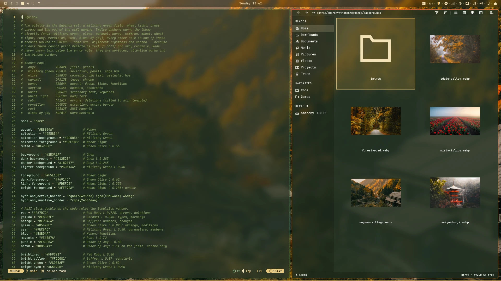

# Equinox

An Omarchy theme for autumn: a dark onyx-green field, wheat light, brass for focus, and vermillon red kept for errors and the active window border. Five autumn wallpapers, each with a matching intro clip that resolves to its still.



## Install

```bash
omarchy theme install https://github.com/Binz120/equinox
omarchy theme set equinox
```

`Super + Ctrl + Space` opens the wallpaper picker; `omarchy theme bg next` cycles.

## Palette

Twelve anchors define the palette; every other role walks one of them in OKLCH (same hue, new lightness/chroma) — a dark field can't print `#A4161A` as text at 1.56:1.

| Role | Colour | Anchor | Contrast on field |
|---|---|---|---|
| Field (background) | `#2B3A2A` | Onyx | n/a |
| Panels | `#212E20` | Onyx L 0.285 | n/a |
| Raised cards | `#305134` | Military Green L 0.40 | n/a |
| Deepest chrome | `#182417` | Onyx L 0.245 | n/a |
| Body text | `#F5E1B8` | Wheat Light | 9.39 |
| Cursor | `#FFF9EA` | Wheat Light L 0.985 | 11.48 |
| Dim text | `#76914C` | Green Olive L 0.62 | 3.40 (chrome) |
| Comments (muted) | `#94B06A` | Green Olive L 0.72 | 4.98 |
| Accent: focus, links, functions | `#E8B04A` | Honey | 6.17 |
| Selection | `#2E5B34` | Military Green | 6.14 with wheat |
| Keywords | `#FEF2D9` | Wheat L 0.965 | 10.86 |
| Types | `#E8C87E` | Caramel L 0.845 | 7.46 |
| Numbers | `#E9C46A` | Saffron | 7.22 |
| Strings | `#B5D28E` | Green Olive L 0.825 | 7.22 |
| Parameters, properties | `#9ECBA6` | Military Green L 0.80 | 6.63 |
| Errors, deletions | `#F67D72` | Red Ruby L 0.725 | 4.65 |
| ANSI magenta | `#E4887A` | Rust L 0.72 | 4.65 |
| ANSI brown | `#AC7957` | Black of Jay L 0.62 | 3.23 (chrome) |

Low-contrast chrome is deliberate: `dark_foreground` (line numbers, ANSI 8) and `brown` (eighth ANSI hue) are chrome; `muted` is body-safe at 4.98. All text roles clear 4.5:1 on field and panel. Vermillon `#D64933` (2.79:1) is surfaces and gradient stops only, never type; the bar's attention role uses lifted ruby at 5.48:1.

## Border

Active and grouped windows get a red-to-brass gradient defined in `colors.toml`:

```toml
hyprland_active_border = "rgba(d64933ee) rgba(e8b04aee) 45deg"
hyprland_inactive_border = "rgba(2e5b34aa)"
```

Omarchy renders it into the compositor config at staging, so the border cannot drift from the palette.

## Files

| File | What it does |
|---|---|
| `colors.toml` | The palette; Omarchy generates terminals, editors and AI CLIs from it. Equinox ships `gtk.css`, `shell.toml` and `btop.theme`. |
| `shell.toml` | Shell surfaces: bar, popups, menus, notifications, launcher, polkit, lock card. |
| `gtk.css` | GTK3/4, libadwaita and plain GTK: Lora titles, sans body. |
| `btop.theme` | Graphs warm green → brass; heat burns honey-white. |
| `fastfetch.jsonc` | fastfetch layout in theme colours. |
| `lazygit.yml` | lazygit colours, mirrors `colors.toml`. |
| `vencord.theme.css` | Vencord / Vesktop theme. |
| `icons.theme` | `Yaru-sage-dark`. |
| `backgrounds/` | Five stills plus an intro clip each. |
| `preview.webp`, `preview-clean.webp` | The work screen and the clean desktop, 1920x1080 lossless. |
| `fonts/` | Lora Regular and Italic (SIL OFL 1.1); install to `~/.local/share/fonts`. |

Equinox ships its own `gtk.css`, `shell.toml` and `btop.theme`, replacing Omarchy's generated ones, and skips `chromium.theme` because the generated file is identical.

## Apps outside Omarchy's theming

Each reads its own user-level config. Install the hook once; it links fastfetch
and lazygit only while the active theme ships the file, removes the links when
it does not, and copies and enables Vencord's sheet (restart Discord/Vesktop):

```bash
mkdir -p ~/.config/omarchy/hooks/theme-set.d
cp ~/.config/omarchy/themes/equinox/hooks/theme-set.d/40-equinox-apps ~/.config/omarchy/hooks/theme-set.d/
```

The manual equivalents:

```bash
# lazygit
mkdir -p ~/.config/lazygit && ln -sfn ~/.local/state/omarchy/current/theme/lazygit.yml ~/.config/lazygit/config.yml

# fastfetch
mkdir -p ~/.config/fastfetch && ln -sfn ~/.local/state/omarchy/current/theme/fastfetch.jsonc ~/.config/fastfetch/config.jsonc

# Vencord / Vesktop: the hook copies and enables it; restart the app
cp ~/.local/state/omarchy/current/theme/vencord.theme.css ~/.config/Vencord/themes/equinox.theme.css
```

Steam and Firefox-derived browsers are not covered: neither exposes a palette hook a theme can write.

## Wallpapers

| File | Scene | Photographer |
|---|---|---|
| `nagano-village.webp` | Nagano valley, footbridge over a ravine, gold slopes | Marcel Bisig |
| `forest-road.webp` | Single-lane road under yellow maple | Angelika Stephan |
| `misty-tulips.webp` | Groningen tulip fields at sunrise, fog in the furrows | René de Vries |
| `edale-valley.webp` | Misty morning track through Edale | Andy Gray |
| `seiganto-ji.webp` | Pagoda at Seiganto-ji, waterfall and autumn mountains | Alex Mesmer |

Default is `edale-valley.webp`, the alphabetically first still. The previews use `nagano-village.webp`. Each still has `intros/<name>.mp4`: 5.4s, silent, starting 6% tighter and drifting from the upper left back to the exact framing; the last frame is the still.

Photo sources: [yqvj5g](https://wallhaven.cc/w/yqvj5g), [5y3721](https://wallhaven.cc/w/5y3721), [vpdmll](https://wallhaven.cc/w/vpdmll), [3q5mx9](https://wallhaven.cc/w/3q5mx9), [w5x99p](https://wallhaven.cc/w/w5x99p), in table order.

## Licence

Theme files (palette, shell surfaces, colour files) are MIT; see `LICENSE`. Photographs remain their authors'. Lora is under the SIL OFL 1.1 (`fonts/OFL.txt`). Icons are `Yaru-sage-dark` from the Yaru project; the theme only names them.
